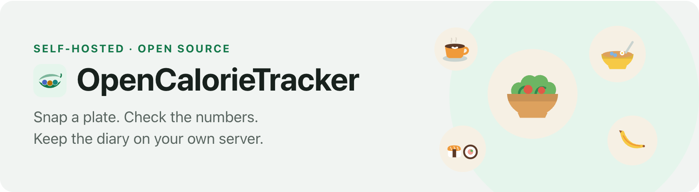
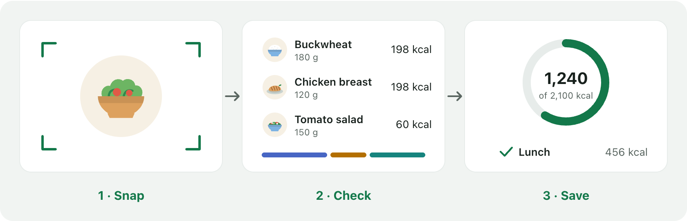
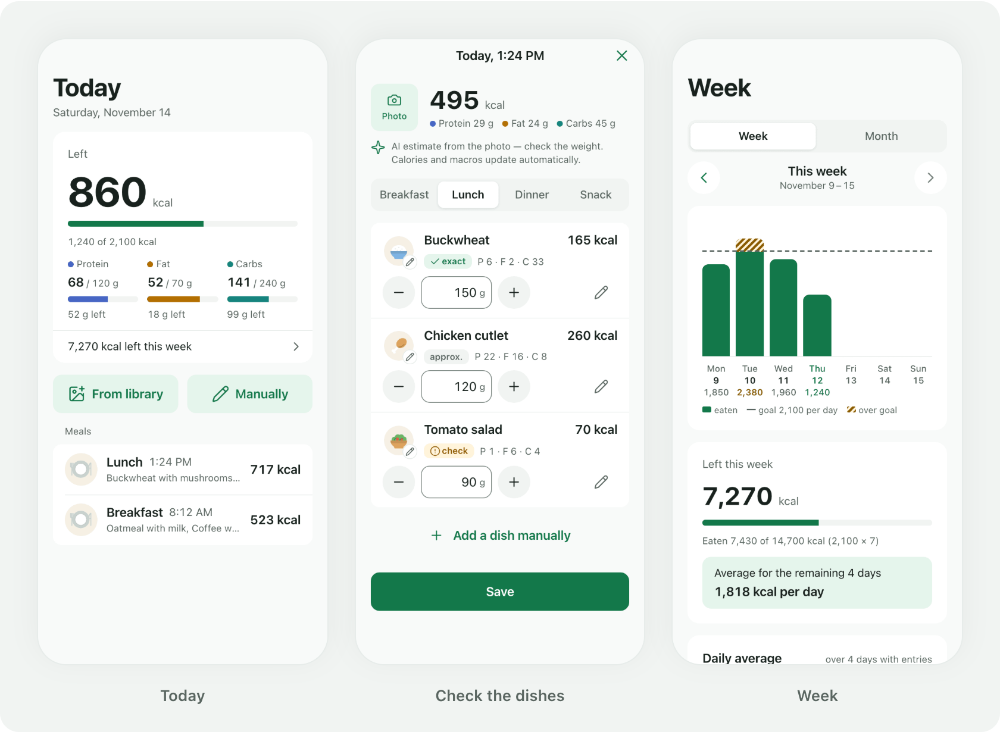
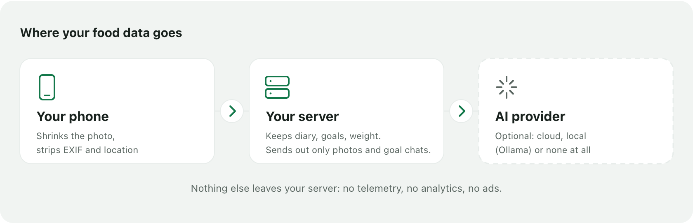

<picture>
  <source media="(prefers-color-scheme: dark)" srcset="docs/assets/readme/banner-dark.png">
  
</picture>

[](LICENSE)
[](https://github.com/mastekator/OpenCalorieTracker/actions/workflows/ci.yml)

Take a photo of your plate. A vision model of your choice lists the dishes with grams, kcal, protein, fat and carbs. Fix what's off, save it to your diary. No AI? Type it in.

<picture>
  <source media="(prefers-color-scheme: dark)" srcset="docs/assets/readme/steps-dark.png">
  
</picture>

## Screens

<picture>
  <source media="(prefers-color-scheme: dark)" srcset="docs/assets/readme/screens-dark.png">
  
</picture>

## Where your data lives

<picture>
  <source media="(prefers-color-scheme: dark)" srcset="docs/assets/readme/data-path-dark.png">
  
</picture>

|                       | Stays on your server                             | Leaves it                                                                                                |
| --------------------- | ------------------------------------------------ | -------------------------------------------------------------------------------------------------------- |
| Diary, weight history | Yes                                              | Never                                                                                                    |
| Goal assistant chat   | Yes                                              | Your answers (age, height, weight, goal), only if you set your goal by chatting. The form sends nothing. |
| Food photo            | A small preview; originals as long as you choose | A resized copy, only to the AI provider you set up. With a local model or without AI — nothing.          |
| Location, EXIF        | Stripped on the phone                            | Never                                                                                                    |
| Usage data            | Not collected                                    | No telemetry, no analytics                                                                               |

On the free tier of Google Gemini, Google may use your requests to improve its products. Pick a paid tier, another provider or a local model if that matters.

## What it is — and isn't

| It is                                              | It isn't                           |
| -------------------------------------------------- | ---------------------------------- |
| A quick estimate from a photo, often within 20–30% | Medical or dietary advice          |
| A diary for you and the people you invite          | An account in someone else's cloud |
| Free and open source, one Docker container         | Ads, subscriptions or upsells      |

Daily goals are approximate. Talk to a doctor or dietitian about your nutrition.

## Run it

```sh
curl -O https://raw.githubusercontent.com/mastekator/OpenCalorieTracker/main/docker-compose.yml
curl -o .env https://raw.githubusercontent.com/mastekator/OpenCalorieTracker/main/.env.example
# edit .env: PUBLIC_URL
docker compose up -d
docker compose logs opencalorietracker | grep "Setup code"
```

Open `PUBLIC_URL` and create the admin account with that code. Then connect an AI provider, if you want one, in Settings → AI provider. Put it behind a reverse proxy with HTTPS. Runs on a home server, NAS, Raspberry Pi or VPS. Step by step, with HTTPS, AI, updates and backups: [Installation](docs/SELF_HOSTING.md#installation).

## Questions

<details open>
<summary>Which AI model should I pick?</summary>

Any model that reads images: Gemini, OpenAI, Anthropic, OpenRouter, or a local one through Ollama, or any OpenAI-compatible endpoint. See which ones pass our test photos in [Tested models](docs/MODELS.md).

</details>

<details>
<summary>How much does one photo cost?</summary>

One resized photo is one request. With a cloud model it's usually well under one US cent; with a local model it's free.

</details>

<details>
<summary>Does it work without AI?</summary>

Yes. Leave the provider empty and enter food by hand; everything else works the same.

</details>

<details>
<summary>Can my family use it?</summary>

Yes. Send an invite link — each person gets their own diary and goal.

</details>

## More

<details>
<summary>Everything it does</summary>

- Photo, library, or drag and paste on desktop
- Edit names and portions, add or remove dishes, recalculate
- Today, diary by day, week and month charts
- Daily goal from your body data, with a step-by-step explanation, or your own numbers
- Set your goal in a form or by chatting with the goal assistant (needs AI)
- Metric and US units
- Passkeys and passwords, invites, admin
- Install to home screen, works offline, light and dark
- English and Russian

</details>

[Self-hosting](docs/SELF_HOSTING.md) · [How the daily goal is calculated](docs/DAILY_GOAL.md) · [Export format](docs/export-format.md) · [Tested models](docs/MODELS.md) · [Roadmap](ROADMAP.md) · [Changelog](CHANGELOG.md) · [Contributing](CONTRIBUTING.md)

## License

[AGPL-3.0](LICENSE). If you run a modified version for others, offer them its source.
