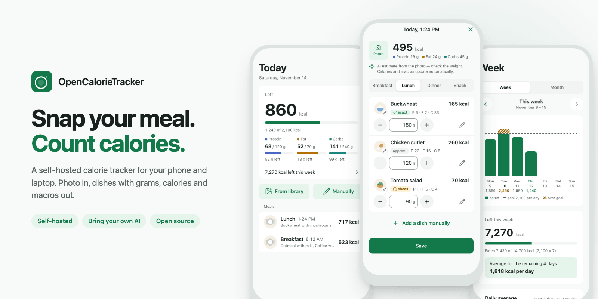
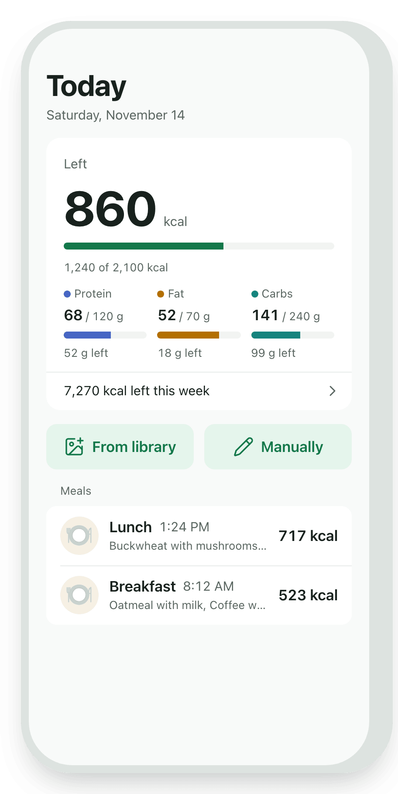
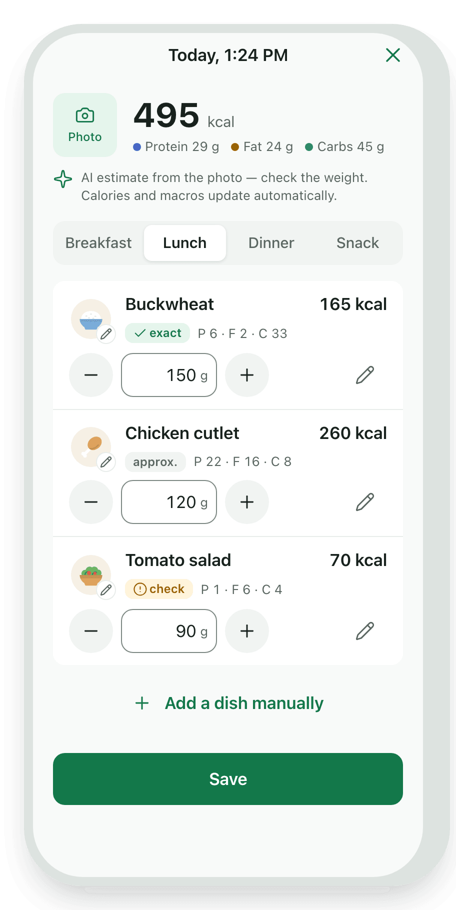
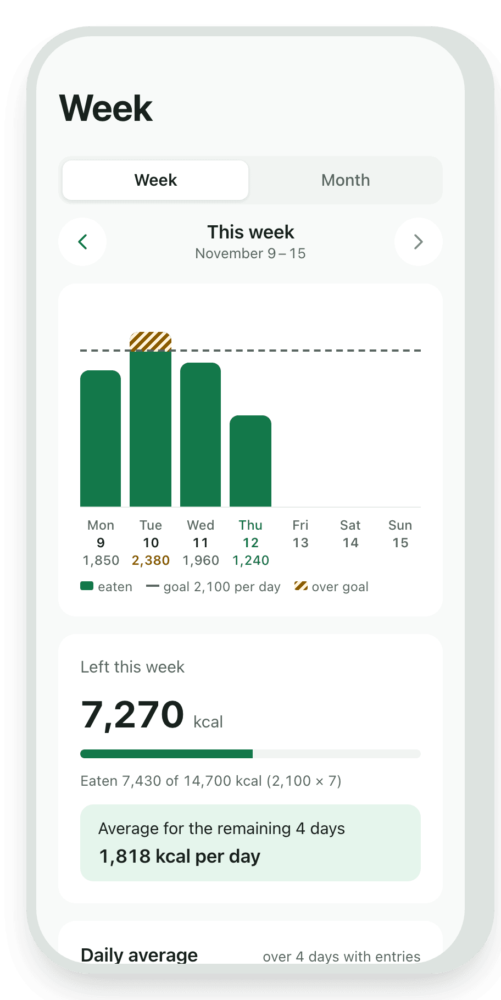
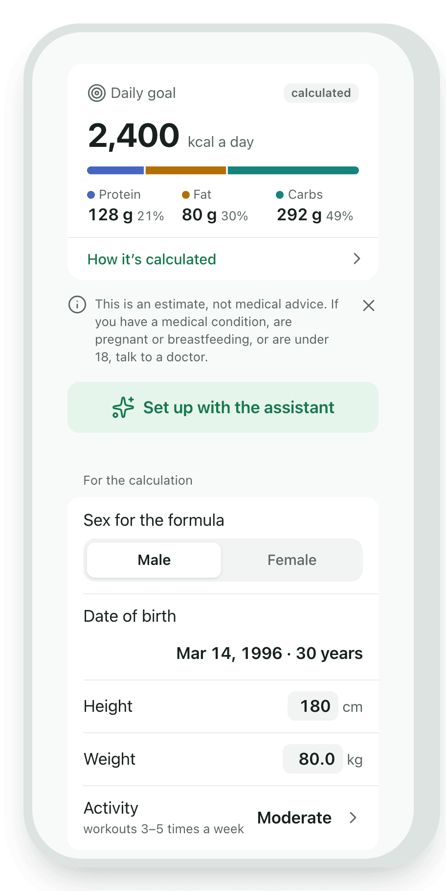

<div align="center">

<picture>
  <source media="(prefers-color-scheme: dark)" srcset="docs/assets/hero-dark.png">
  
</picture>

# OpenCalorieTracker

Self-hosted calorie tracker that works from a photo.

[](https://github.com/mastekator/OpenCalorieTracker/stargazers)
[](https://github.com/mastekator/OpenCalorieTracker/releases)
[](https://github.com/mastekator/OpenCalorieTracker/actions/workflows/ci.yml)
[](LICENSE)

[](docs/SELF_HOSTING.md)

[Roadmap](ROADMAP.md) · [Changelog](CHANGELOG.md)

</div>

## Status

🚧 **In development.** Nothing to install yet.

## Why OpenCalorieTracker

Your food diary is personal. OpenCalorieTracker runs on your own server, keeps your data there, and has no subscription, no ads and no telemetry. Invite your family or friends — each gets their own diary.

Snap your plate, and an AI vision model of your choice estimates the dishes with grams, kcal, protein, fat and carbs; you fix what's off and save. The whole app is one Docker container with SQLite: one `docker compose up` on a home server, NAS, Raspberry Pi or VPS.

## Features

**Photo and recognition**

- Take a photo, pick one from the library, or drag and paste it on desktop.
- Dishes come back with grams, kcal and macros; edit names and portions, add or remove dishes, recalculate.
- Pluggable AI provider: Gemini, OpenAI, Anthropic, OpenRouter, Ollama or any OpenAI-compatible endpoint. AI is optional — without it, enter food manually.
- Photos are resized and stripped of EXIF on your phone; you choose how long originals are kept.

**Diary and week**

- Today screen with what's left of your goal and macros.
- Diary by day: add entries for any date, delete with undo.
- Week and month view with a calories-by-day chart, totals and a daily average.

**Profile and daily goal**

- Daily goal from your body data, activity and target (lose, maintain, gain), with a step-by-step explanation.
- Set it up in a form or by chatting with the goal assistant (needs AI); or enter your own numbers.
- Metric and US units.

**Sign-in and users**

- Passkeys and passwords; choose which are enabled.
- Sign-up by invite link or open registration.
- Admin: invites, users, recovery links, sign-in blocks.

**Offline and PWA**

- Install it on your phone's home screen or desktop.
- Works offline; changes sync when you're back online.
- Light and dark themes.

**Languages**

- English and Russian.

## Screenshots

<p align="center">
  
  
  
  
</p>

## Quick start

```sh
curl -O https://raw.githubusercontent.com/mastekator/OpenCalorieTracker/main/docker-compose.yml
printf 'PUBLIC_URL=https://food.example.com\nADMIN_EMAIL=you@example.com\nADMIN_PASSWORD=change-me-1!\n' > .env
docker compose up -d
```

Put it behind a reverse proxy with HTTPS. All settings are in [docs/SELF_HOSTING.md](docs/SELF_HOSTING.md).

## Tested models

Results of `check-model` on the [test photos](apps/server/test-photos/README.md): 9 CC0 / public domain photos with rough kcal ranges and expected confidence. To check your model, from a clone of this repository:

```sh
pnpm install
AI_PROVIDER=google AI_MODEL=gemini-2.5-flash AI_API_KEY=... pnpm --filter @oct/server check-model
```

It prints a table per photo and `N/9 passed`. Send a pull request with your row:

| Provider                                           | Model | Passed | Date | Notes |
| -------------------------------------------------- | ----- | ------ | ---- | ----- |
| _No results yet — run `check-model` and send a PR_ |       |        |      |       |

## How the daily goal is calculated

The app explains your own numbers step by step under **Profile → How it’s calculated**. This is the general formula behind it (`packages/shared/src/norm/calculate.ts`). In US units, height and weight are converted to cm and kg first.

1. **Energy at rest** (basal metabolic rate, Mifflin–St Jeor), age in full years:
   - men: `10 × weight (kg) + 6.25 × height (cm) − 5 × age + 5`
   - women: `10 × weight (kg) + 6.25 × height (cm) − 5 × age − 161`
2. **A typical day** (total daily energy expenditure) = energy at rest × activity factor:

   | Activity  | Typical day                              | Factor |
   | --------- | ---------------------------------------- | ------ |
   | Minimal   | desk job, almost no exercise             | 1.2    |
   | Light     | light workouts or walks 1–3 times a week | 1.375  |
   | Moderate  | workouts 3–5 times a week                | 1.55   |
   | High      | hard workouts 6–7 times a week           | 1.725  |
   | Very high | physical labour or 2 workouts a day      | 1.9    |

3. **Goal.** Maintain: no change. Lose or gain: the pace is the target weight over the weeks to the chosen date, or by default 0.5% of body weight a week to lose and 0.25% to gain. The daily change is `pace (kg/week) × 7,700 / 7` kcal (1 kg of body fat ≈ 7,700 kcal). The pace is flagged, never blocked: losing over 1% of body weight a week is fast, over 1.5% may harm health, gaining over 0.5% adds mostly fat.
4. **Safe minimum** (only when losing): the goal never goes below 1,200 kcal for women and 1,500 kcal for men. If the typical day is already below that, the goal is the typical day with no deficit.
5. **Rounding:** the goal is rounded to 10 kcal; macros are counted from the rounded goal.
6. **Macros:** protein 1.6 g per kg of body weight, kept within 10–35% of kcal; fat 30% of kcal; carbs the rest. 4 kcal per gram of protein and carbs, 9 per gram of fat; each rounded to a whole gram.

A goal set manually replaces the calculation. Real energy use differs between people by about 10%, so update your weight every 1–2 weeks and adjust the goal if your weight doesn’t change as expected.

**Sources**

- Mifflin M. D., St Jeor S. T. et al. A new predictive equation for resting energy expenditure in healthy individuals. _Am J Clin Nutr._ 1990;51(2):241–247. [doi:10.1093/ajcn/51.2.241](https://doi.org/10.1093/ajcn/51.2.241)
- Frankenfield D. et al. Comparison of predictive equations for resting metabolic rate in healthy nonobese and obese adults: a systematic review. _J Am Diet Assoc._ 2005;105(5):775–789. [doi:10.1016/j.jada.2005.02.005](https://doi.org/10.1016/j.jada.2005.02.005)
- FAO/WHO/UNU. [_Human energy requirements._](https://www.fao.org/4/y5686e/y5686e00.htm) 2004 (physical activity levels).
- McArdle W. D., Katch F. I., Katch V. L. _Exercise Physiology_ (activity factor scale).
- Hall K. D. et al. Quantification of the effect of energy imbalance on bodyweight. _Lancet._ 2011;378(9793):826–837. [doi:10.1016/S0140-6736(11)60812-X](<https://doi.org/10.1016/S0140-6736(11)60812-X>)
- Helms E. R. et al. Evidence-based recommendations for natural bodybuilding contest preparation: nutrition and supplementation. _JISSN._ 2014;11:20. [doi:10.1186/1550-2783-11-20](https://doi.org/10.1186/1550-2783-11-20)
- Roberts B. M., Helms E. R. et al. Nutritional recommendations for physique athletes. _J Hum Kinet._ 2020;71:79–108. [doi:10.2478/hukin-2019-0096](https://doi.org/10.2478/hukin-2019-0096)
- Turocy P. S. et al. NATA position statement: safe weight loss and maintenance practices in sport and exercise. _J Athl Train._ 2011;46(3):322–336. [doi:10.4085/1062-6050-46.3.322](https://doi.org/10.4085/1062-6050-46.3.322)
- Iraki J. et al. Nutrition recommendations for bodybuilders in the off-season. _Sports._ 2019;7(7):154. [doi:10.3390/sports7070154](https://doi.org/10.3390/sports7070154)
- NIH/NHLBI. [_Clinical Guidelines on the Identification, Evaluation, and Treatment of Overweight and Obesity in Adults._](https://www.nhlbi.nih.gov/files/docs/guidelines/ob_gdlns.pdf) 1998.
- Morton R. W. et al. A systematic review, meta-analysis and meta-regression of the effect of protein supplementation on resistance training-induced gains in muscle mass and strength. _Br J Sports Med._ 2018;52(6):376–384. [doi:10.1136/bjsports-2017-097608](https://doi.org/10.1136/bjsports-2017-097608)
- Jäger R. et al. ISSN Position Stand: protein and exercise. _JISSN._ 2017;14:20. [doi:10.1186/s12970-017-0177-8](https://doi.org/10.1186/s12970-017-0177-8)
- Institute of Medicine. _Dietary Reference Intakes for Energy, Carbohydrate, Fiber, Fat, Fatty Acids, Cholesterol, Protein, and Amino Acids._ 2005 (AMDR). [doi:10.17226/10490](https://doi.org/10.17226/10490)
- WHO. [_Healthy diet._](https://www.who.int/news-room/fact-sheets/detail/healthy-diet) Fact sheet.
- WHO. [Body mass index](https://www.who.int/data/gho/data/themes/topics/topic-details/GHO/body-mass-index) (BMI under 18.5 is underweight).

## Privacy

- Your diary and photo previews stay on your server.
- **Food photos are sent to the AI provider you configure.** On the **free tier of Google Gemini**, Google may use your requests to improve its products. If that matters to you, use a paid tier, another provider, a local model (e.g. Ollama), or run without AI and enter food manually.
- Photos are resized and stripped of EXIF (including location) on your phone before they leave it.

## Disclaimer

OpenCalorieTracker is **not medical advice**. Calorie and macro values from photos are estimates (often ±20–30%), and daily targets are approximate. Talk to a doctor or dietitian about your nutrition.

## Contributing

See [CONTRIBUTING.md](CONTRIBUTING.md).

## License

[AGPL-3.0](LICENSE). If you run a modified version as a service, you must publish its source.
